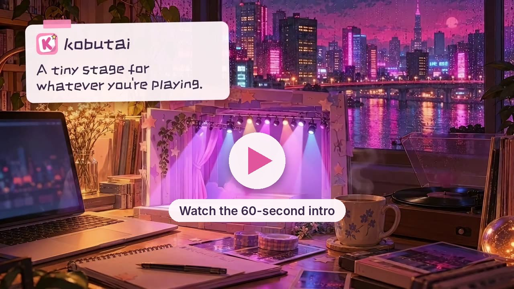
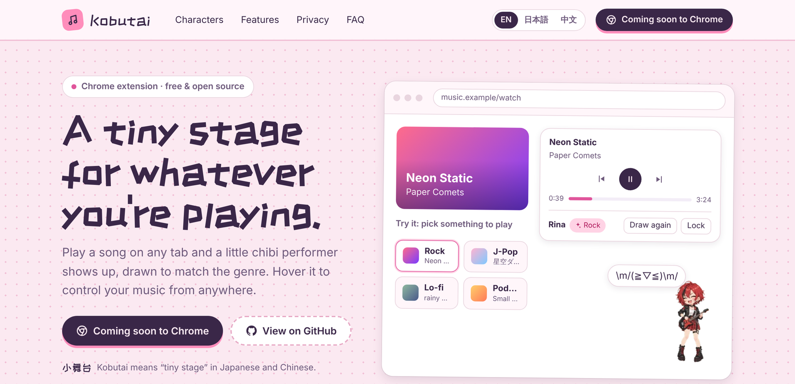
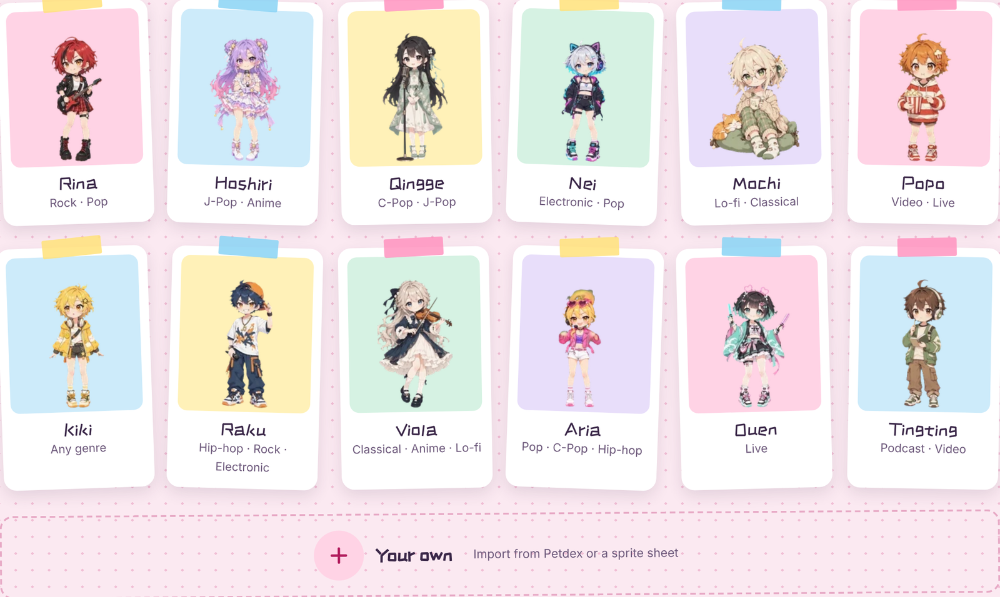
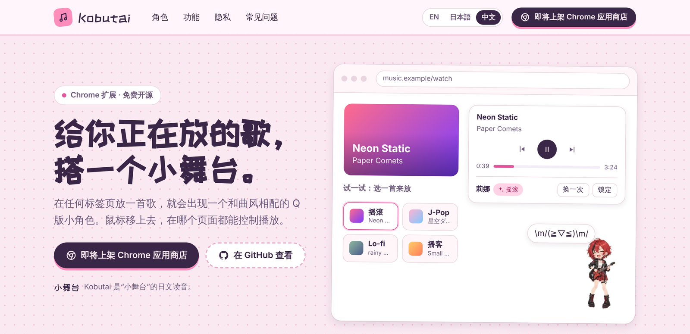
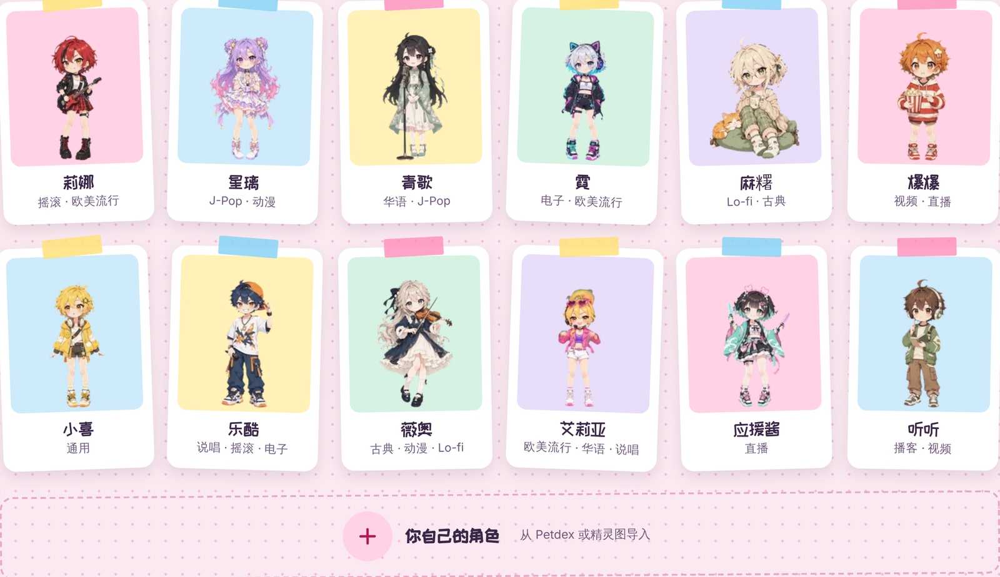

<div align="center">


# Kobutai 小舞台

**A tiny stage for whatever you're playing.**<br>
**给你正在放的歌，搭一个小舞台。**

[English](#english) · [中文](#中文) · [Website 官网](https://kobutai.pages.dev) · [Kobutai Model 1.0](https://github.com/xingaobio/kobutai-model)


[](https://chromewebstore.google.com/detail/dmoinepmnonlmffdeelhgbobllhejpfc)
[](https://microsoftedge.microsoft.com/addons/detail/oeajknlpejimdfgpipgkgoilhmdlgpgg)

</div>

<p align="center"><a href="https://kobutai.pages.dev/#video"></a></p>

---

<a id="english"></a>

## English



Play something on any tab and a little chibi performer pops up in the corner, drawn to match what's on: a guitarist for rock, a violinist for classical, a popcorn kid for a funny video. Hover over it to play, pause, skip or seek, even when the music lives in another tab.

*Kobutai* (小舞台, こぶたい) means "tiny stage" in Japanese and Chinese.

### Features

| | |
|---|---|
| 🎭 **A draw for every song** | Each new song or video draws one character from the pool for its genre. Draw again once, or lock a favourite. |
| 🧠 **Knows the genre, offline** | A small model trained for Kobutai reads the title, artist and site on your device: music, video, live or podcast, plus 10 genres. No API key, no audio recording, nothing sent. |
| 🎛️ **Control from any tab** | Hover to play, skip, seek or change volume. There's also a toolbar mini player and a picture-in-picture window. |
| 📒 **Sticker album** | Every character you've drawn is collected in the album. Delete the ones you don't like. |
| 🎨 **Bring your own** | Import community pets from [Petdex](https://petdex.dev), or a sprite sheet you drew yourself, and share it with everyone. |
| 💬 **Little moods** | Kaomoji and animated emoji bubbles say what's on, and each character has lines of its own: a sleepy "So comfy…" on lo-fi, a reply when you tap it. Long videos get a new one every few minutes. |
| 🤖 **Optional AI** | Connect your own model (30+ providers, free tiers work) as a second opinion. It's asked only when the built-in model is unsure. |
| 🌏 **Three languages** | English, Japanese and Chinese, following your browser. |

Tuned for YouTube, YouTube Music, Spotify and Bilibili, and works on most other pages that play audio or video.

### The 12 characters



### The built-in model

Kobutai only sees text (title, artist or channel, site, duration), never the audio. The recognition model was trained for this job and ships inside the extension:

| | |
|---|---|
| Size | 2.1 MB model + 0.48 MB artist table |
| Speed | under 1 ms per item, in the browser, no GPU or WebAssembly |
| Accuracy on 383 real chart titles never seen in training | content type 95.6% · fully right 86.9% (the old keyword rules: 59.5%) |
| With an AI connected as a second opinion | about 1 item in 3 is handed over; fully right ≈ 95% |

The training data, experiments (including two that didn't work), charts and parameters are published as **[Kobutai Model 1.0](https://github.com/xingaobio/kobutai-model)**.

### Privacy

No account, no analytics, no servers of ours. Your album and settings stay in your browser. If you connect your own AI, only the title, artist and site of items the built-in model is unsure about go to the provider you picked. Full policy: [kobutai.pages.dev/privacy.html](https://kobutai.pages.dev/privacy.html).

### Install

| | |
|---|---|
| **Chrome** | [Chrome Web Store](https://chromewebstore.google.com/detail/dmoinepmnonlmffdeelhgbobllhejpfc) |
| **Edge** | [Microsoft Edge Add-ons](https://microsoftedge.microsoft.com/addons/detail/oeajknlpejimdfgpipgkgoilhmdlgpgg) (also works in mainland China) |
| **Other Chromium browsers** (360, QQ Browser, Brave, Opera…) | [kobutai-extension.zip](https://github.com/xingaobio/kobutai/releases/latest/download/kobutai-extension.zip), see [Manual install](#manual-install) |
| **Windows desktop app** (preview) | [kobutai-windows-setup.exe](https://github.com/xingaobio/kobutai/releases/latest/download/kobutai-windows-setup.exe) |
| **Build it yourself** | `git clone https://github.com/xingaobio/kobutai.git && cd kobutai && npm install && npm run build`, then load `.output/chrome-mv3` as below |

Then play a song on YouTube or Spotify. Every version is on the [Releases](https://github.com/xingaobio/kobutai/releases) page; step-by-step help for every browser and Windows is in the [install guide](https://kobutai.pages.dev/install.html).

#### Manual install

1. Download [kobutai-extension.zip](https://github.com/xingaobio/kobutai/releases/latest/download/kobutai-extension.zip) and unzip it.
2. Open the browser's extensions page (`chrome://extensions`, `edge://extensions`; in 360 or QQ Browser, the extension manager in the menu).
3. Turn on **Developer mode**, click **Load unpacked** and choose the unzipped folder.

Manual installs don't update themselves: download the new zip from Releases when a new version comes out. The Windows installer isn't signed yet, so Windows may show "Windows protected your PC": click **More info** → **Run anyway**.

Feedback is very welcome: open an issue, or email xingaouk@gmail.com.

### Develop

```bash
npm run dev     # Chrome with hot reload
npm run check   # typecheck + unit tests + build
npm run e2e     # end-to-end tests with Playwright
```

Architecture, character pack format and character library: [docs/development/DEVELOPMENT.md](docs/development/DEVELOPMENT.md) (Chinese). Design notes: [docs/product/DESIGN.md](docs/product/DESIGN.md). About the model in the extension: [docs/development/CLASSIFIER.md](docs/development/CLASSIFIER.md).

### Credits and license

- Code: MIT.
- Built-in model (`public/model/`): CC BY-NC 4.0, see [`public/model/LICENSE.md`](public/model/LICENSE.md). Also on [Hugging Face](https://huggingface.co/xingaouk/kobutai-media-classifier).
- Built-in characters © Kobutai; each pack declares its own licence in `pack.json`. Shared characters are published under CC BY 4.0 with credit to their artists.
- Emoji animations: [Google Noto Emoji](https://googlefonts.github.io/noto-emoji-animation/), CC BY 4.0.
- Title font: ZCOOL KuaiLe, SIL OFL 1.1.
- AI providers via [pi-ai](https://github.com/earendil-works/pi/tree/main/packages/ai).

---

<a id="中文"></a>

## 中文



在任何标签页放一首歌，网页角落就会出现一个和曲风相配的 Q 版小角色：摇滚是弹吉他的莉娜，古典是拉小提琴的薇奥，搞笑视频是抱着爆米花的爆爆。鼠标移上去就能播放、暂停、切歌、拖进度，音乐在别的标签页里也能控制。

*Kobutai* 是"小舞台"（こぶたい）的日文读音。

### 功能

| | |
|---|---|
| 🎭 **每首歌抽一次** | 每放一首新歌或一个新视频，就从对应曲风的角色池里抽一个出场。可以"换一次"，也可以锁定喜欢的角色。 |
| 🧠 **离线听出曲风** | 专门为 Kobutai 训练的小模型在你的电脑上读标题、作者和网站名，判断是音乐、视频、直播还是播客，以及 10 种曲风。不用 API key，不录音，什么都不发送。 |
| 🎛️ **跨标签页控制** | 悬停即可播放、切歌、拖进度、调音量；工具栏还有迷你播放器和画中画悬浮窗。 |
| 📒 **贴纸图鉴** | 抽到过的角色都收进图鉴，不喜欢的可以删掉。 |
| 🎨 **导入自己的角色** | 从 [Petdex](https://petdex.dev) 导入社区角色，或导入自己画的精灵图，还可以投稿分享给所有人。 |
| 💬 **小表情** | 颜文字和动态表情气泡说明正在放什么，每个角色还会用自己的口吻说话：Lo-fi 时说"好舒服……"，被点到时有反应。长视频每隔几分钟换一个。 |
| 🤖 **可选的 AI** | 连上你自己的模型（30 多家服务商，免费额度就够）做第二意见，只在内置模型没把握时才问它。 |
| 🌏 **三种语言** | 中文、英文、日文，默认跟随浏览器。 |

已适配 YouTube、YouTube Music、Spotify、哔哩哔哩，其他能放音视频的网页大多也能用。

### 12 个角色



### 内置模型

Kobutai 只能读到文字（标题、歌手或频道、网站、时长），听不到声音。识别模型是专门为这件事训练的，直接打包在扩展里：

| | |
|---|---|
| 体积 | 模型 2.1 MB + 歌手表 0.48 MB |
| 速度 | 浏览器里每条不到 1 毫秒，不需要 GPU 或 WebAssembly |
| 在 383 条训练时没见过的真实榜单标题上 | 内容类型 95.6%，完全判对 86.9%（原来的关键词规则是 59.5%） |
| 连上 AI 做第二意见时 | 约三分之一的内容交给 AI，完全判对约 95% |

训练数据、实验（包括两次没成功的尝试）、图表和参数都公开在 **[Kobutai Model 1.0](https://github.com/xingaobio/kobutai-model)**。

### 隐私

不需要账号，没有统计，开发者不运营任何服务器。图鉴和设置都保存在你的浏览器里。连上自己的 AI 时，也只把内置模型没把握的那些内容的标题、作者和网站名发给你选的服务商。完整政策：[kobutai.pages.dev/privacy.html](https://kobutai.pages.dev/privacy.html)。

### 安装

| | |
|---|---|
| **Chrome** | [Chrome 应用商店](https://chromewebstore.google.com/detail/dmoinepmnonlmffdeelhgbobllhejpfc) |
| **Edge** | [Microsoft Edge 加载项商店](https://microsoftedge.microsoft.com/addons/detail/oeajknlpejimdfgpipgkgoilhmdlgpgg)（国内可以正常访问） |
| **其他 Chromium 内核浏览器**（360、QQ 浏览器、Brave、Opera…） | [kobutai-extension.zip](https://github.com/xingaobio/kobutai/releases/latest/download/kobutai-extension.zip)，见下面的"手动安装" |
| **Windows 桌面版**（预览） | [kobutai-windows-setup.exe](https://github.com/xingaobio/kobutai/releases/latest/download/kobutai-windows-setup.exe) |
| **自己构建** | `git clone https://github.com/xingaobio/kobutai.git && cd kobutai && npm install && npm run build`，然后按下面的方法加载 `.output/chrome-mv3` |

装好后去 YouTube 或 Spotify 放一首歌试试。所有版本都在 [Releases](https://github.com/xingaobio/kobutai/releases) 页面；每种浏览器和 Windows 的详细步骤见[安装指南](https://kobutai.pages.dev/install.html?lang=zh)。

#### 手动安装

1. 下载 [kobutai-extension.zip](https://github.com/xingaobio/kobutai/releases/latest/download/kobutai-extension.zip) 并解压。
2. 打开浏览器的扩展管理页（`chrome://extensions`、`edge://extensions`；360、QQ 浏览器在菜单里的"扩展管理"）。
3. 开启"开发者模式"，点"加载已解压的扩展程序"，选择解压出来的文件夹。

手动安装不会自动更新，有新版本时请到 Releases 重新下载。Windows 安装包还没有签名，Windows 可能提示"Windows 已保护你的电脑"，点"更多信息"→"仍要运行"。

非常欢迎反馈：提 issue，或发邮件到 xingaouk@gmail.com。

### 开发

```bash
npm run dev     # 启动带热重载的 Chrome
npm run check   # 类型检查 + 单元测试 + 构建
npm run e2e     # 用 Playwright 跑端到端测试
```

架构、角色包格式、远程角色库：[docs/development/DEVELOPMENT.md](docs/development/DEVELOPMENT.md)。设计文档：[docs/product/DESIGN.md](docs/product/DESIGN.md)。扩展里的模型：[docs/development/CLASSIFIER.md](docs/development/CLASSIFIER.md)。

### 致谢与许可

- 代码：MIT。
- 内置模型（`public/model/`）：CC BY-NC 4.0（禁止商用），见 [`public/model/LICENSE.md`](public/model/LICENSE.md)。也发布在 [Hugging Face](https://huggingface.co/xingaouk/kobutai-media-classifier)。
- 内置角色 © Kobutai；每个角色包在 `pack.json` 里单独声明许可。用户投稿的角色以 CC BY 4.0 发布并署名作者。
- 表情动画：[Google Noto Emoji](https://googlefonts.github.io/noto-emoji-animation/)，CC BY 4.0。
- 标题字体：站酷快乐体（ZCOOL KuaiLe），SIL OFL 1.1。
- AI 服务商接入基于 [pi-ai](https://github.com/earendil-works/pi/tree/main/packages/ai)。
